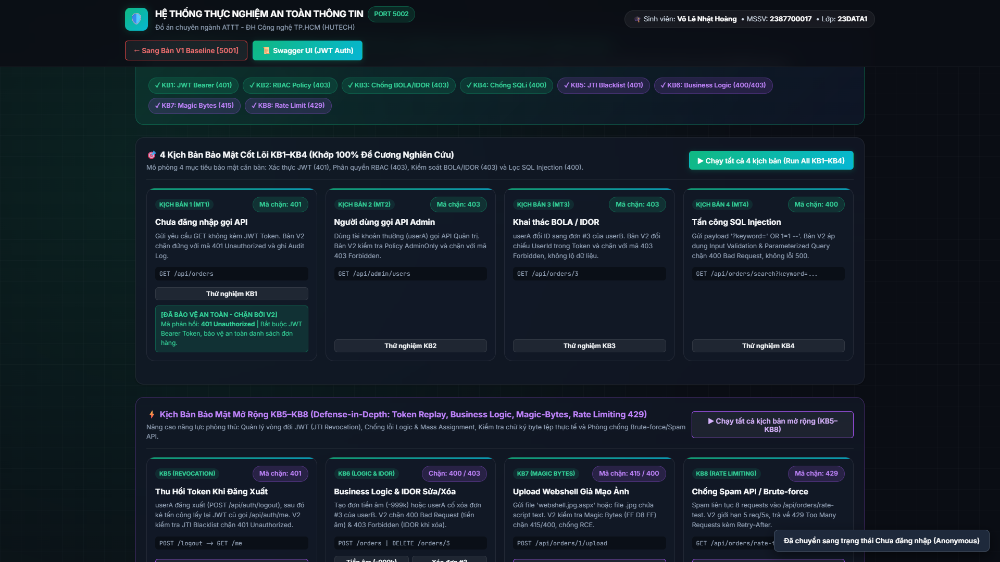
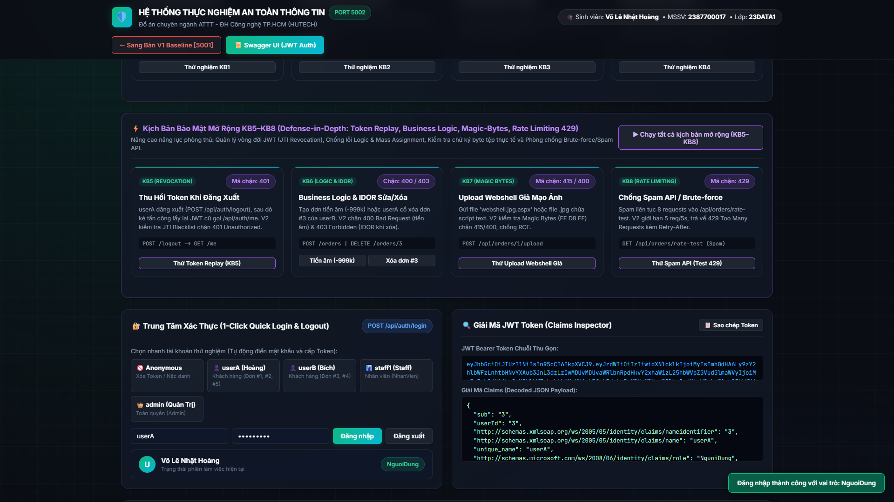
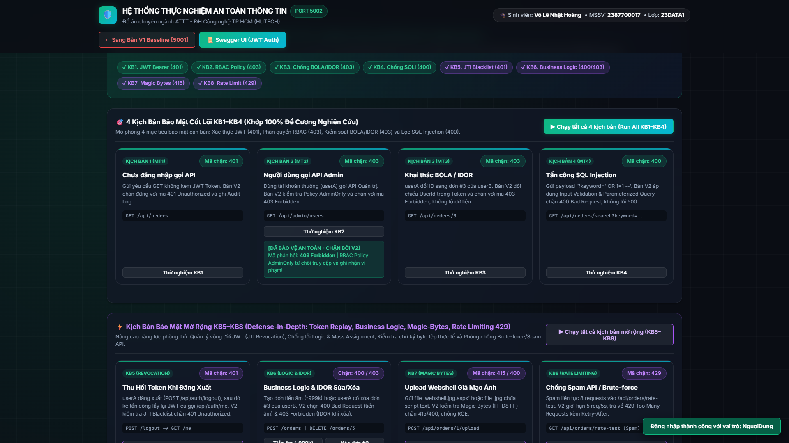
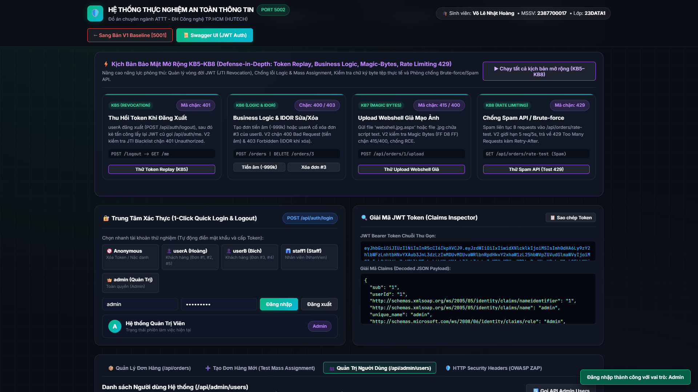
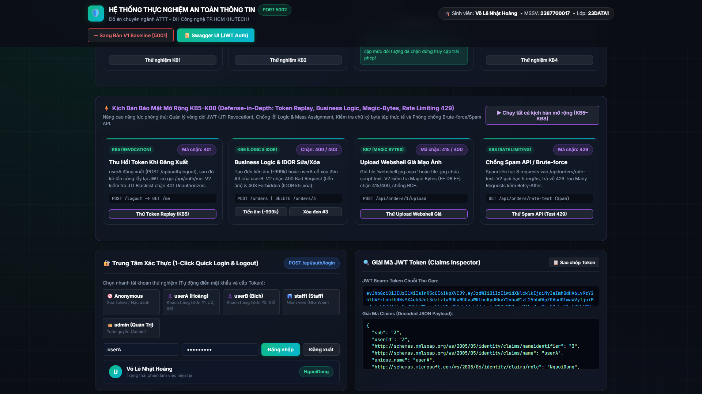
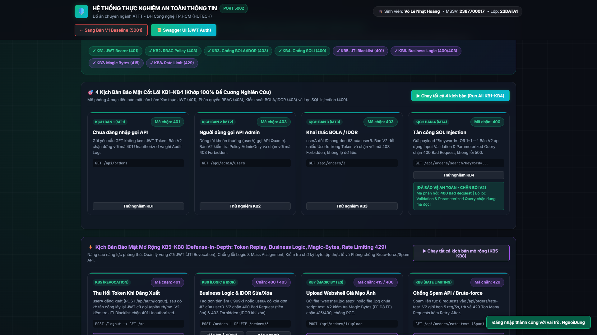
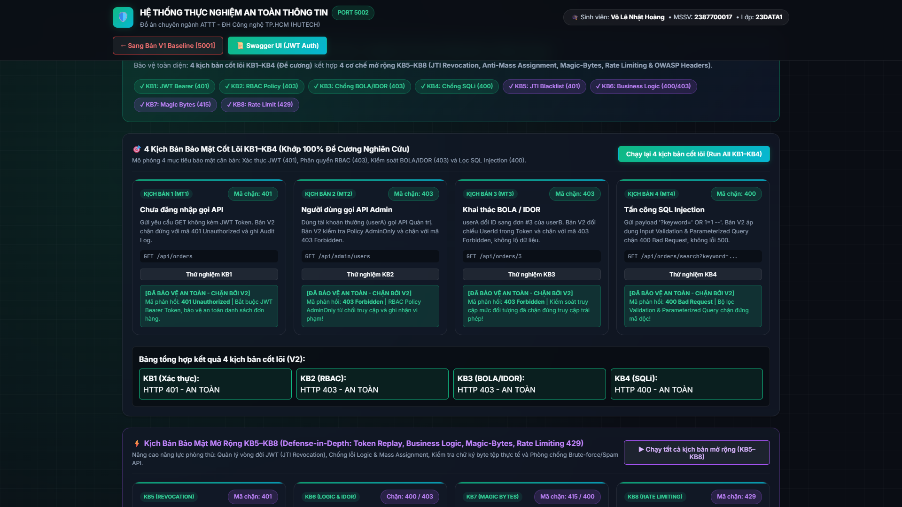
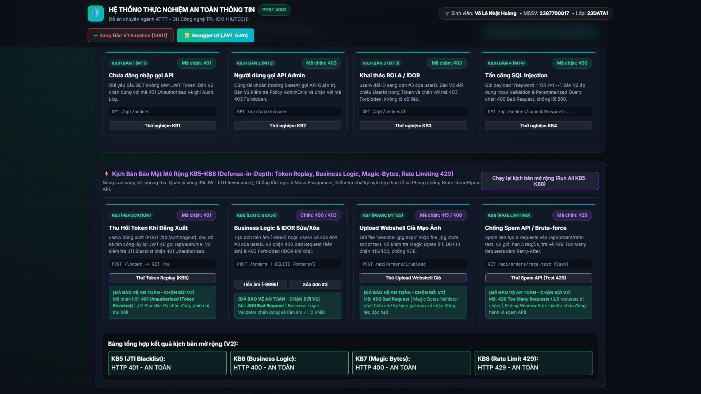
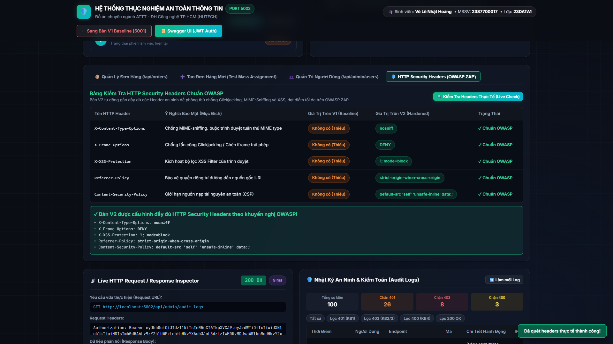
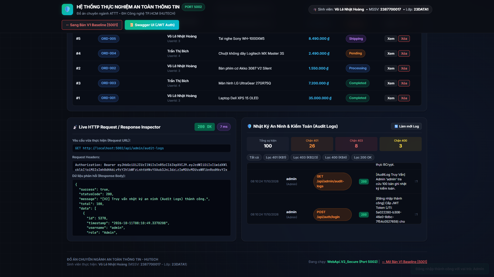

# 🛡️ HỆ THỐNG THỰC NGHIỆM ĐỒ ÁN CHUYÊN NGÀNH AN TOÀN THÔNG TIN

## ĐỀ TÀI: XÂY DỰNG VÀ KIỂM THỬ CÁC CƠ CHẾ BẢO MẬT CHO ỨNG DỤNG WEB/API DỰA TRÊN XÁC THỰC, PHÂN QUYỀN VÀ KIỂM SOÁT TRUY CẬP

- **Sinh viên thực hiện:** **Võ Lê Nhật Hoàng**
- **Mã số sinh viên (MSSV):** **2387700017**
- **Lớp:** **23DATA1**
- **Chuyên ngành:** **An toàn thông tin (ATTT)**
- **Đơn vị:** Viện Công nghệ Thông tin - Trường Đại học Công nghệ TP.HCM (**HUTECH**)

---

## 📌 1. GIỚI THIỆU HAI PHIÊN BẢN WEB ĐỐI CHỨNG (BEFORE / AFTER)

Hệ thống được xây dựng theo mô hình thực nghiệm đối chứng (**Red Team vs Blue Team**) gồm 2 ứng dụng Web/API chạy song song:

| Phiên bản | Địa chỉ chạy | Vai trò trong Đồ án | Giao diện & Đặc điểm kỹ thuật |
| :--- | :--- | :--- | :--- |
| 🔴 **Web V1 (`WebApi.V1_Vulnerable`)** | `http://localhost:5001`<br>[Xem README riêng của V1](./WebApi.V1_Vulnerable/README.md) | **Before (Red Team - Có lỗ hổng)**<br>Dùng để đóng vai **Kẻ tấn công (Attacker)** khai thác trực tiếp 8 lỗ hổng phổ biến nhất trên Web API. | Giao diện tông **Đỏ Cảnh Báo**, lưu mật khẩu Plaintext, thiếu kiểm tra JWT, thiếu RBAC, dính lỗi IDOR Xem/Sửa/Xóa, dính SQL Injection nối chuỗi thô, dính Token Replay sau Logout, chấp nhận đơn tiền âm & Webshell giả mạo ảnh, không có Rate Limit. |
| 🟢 **Web V2 (`WebApi.V2_Secure`)** | `http://localhost:5002`<br>[Xem README riêng của V2](./WebApi.V2_Secure/README.md) | **After (Blue Team - Đã bảo mật)**<br>Dùng để đóng vai **Kỹ sư Bảo mật (Defender)** chứng minh hiệu quả của 8 lớp phòng thủ. | Giao diện tông **Xanh Ngọc An Toàn**, băm mật khẩu **BCrypt**, bắt buộc **JWT Bearer (`401`)**, phân quyền **RBAC `AdminOnly` (`403`)**, chống **BOLA/IDOR (`403`)**, lọc **Regex + Parameterized LINQ (`400`)**, thu hồi **JTI Blacklist (`401`)**, kiểm tra **Magic Bytes (`415`)**, chống Spam **Rate Limit (`429`)**, gắn **5 OWASP Security Headers** & ghi **Audit Logs**. |

---

## 🖥️ 2. HÌNH ẢNH TỔNG QUAN GIAO DIỆN WEB V1 & WEB V2

### 🔴 2.1 Giao diện Tổng quan Web V1 (`http://localhost:5001` - Phiên bản Chưa bảo mật / Red Team)

> **Web V1 (Cổng 5001):** Hiển thị rõ cảnh báo màu đỏ `[PHIÊN BẢN V1 - CHƯA BẢO MẬT]`, tích hợp bộ **1-Click Attack Simulator** cho phép bấm 1 nút để khai thác tức thì 4 kịch bản cốt lõi (`KB1–KB4`) và 4 kịch bản mở rộng (`KB5–KB8`).

---

### 🟢 2.2 Giao diện Tổng quan Web V2 (`http://localhost:5002` - Phiên bản Đã bảo mật / Blue Team)

> **Web V2 (Cổng 5002):** Hiển thị trạng thái màu xanh ngọc `[PHIÊN BẢN V2 - ĐÃ BẢO MẬT 4 LỚP CỐT LÕI + PHÒNG THỦ CHUYÊN SÂU]`, tích hợp trung tâm đăng nhập nhanh 1-Click, bộ giải mã JWT Claims (`sub`, `role`, `jti`), kiểm tra trực tiếp **OWASP HTTP Security Headers** và bảng **Nhật ký Kiểm toán An ninh (Audit Logs)**.

---

## ⚔️ 3. HÌNH ẢNH ĐỐI CHỨNG TRỰC QUAN WEB V1 (BEFORE) VS WEB V2 (AFTER)

### 🔹 Kịch bản 1 (KB1): Kiểm soát Xác thực (Authentication Control - `GET /api/orders`)
- **Mục tiêu:** Chặn truy cập nặc danh (không có JWT Token) vào danh sách đơn hàng nội bộ.

#### 🔴 [BEFORE - Web V1] Chưa đăng nhập vẫn lấy được toàn bộ đơn hàng (`200 OK - LỖ HỔNG`)


#### 🟢 [AFTER - Web V2] Chặn đứng yêu cầu không có Token với mã `401 Unauthorized`


#### 🟢 [AFTER SUCCESS - Web V2] Đăng nhập hợp lệ `userA` -> Cấp JWT kèm `JTI` & chỉ trả về đơn của `userA` (`200 OK`)


---

### 🔹 Kịch bản 2 (KB2): Phân quyền Vai trò Quản trị (RBAC - `GET /api/admin/users`)
- **Mục tiêu:** Ngăn chặn tài khoản khách hàng thường (`userA` - Role `NguoiDung`) gọi API Quản trị viên.

#### 🔴 [BEFORE - Web V1] `userA` gọi được API Admin, lộ toàn bộ mật khẩu Plaintext (`200 OK - LỖ HỔNG`)


#### 🟢 [AFTER - Web V2] Policy `AdminOnly` chặn đứng `userA` với mã `403 Forbidden`


#### 🟢 [AFTER SUCCESS - Web V2] Chỉ `admin` mới xem được danh sách user & mật khẩu đã băm BCrypt an toàn (`200 OK`)


---

### 🔹 Kịch bản 3 (KB3): Kiểm soát Truy cập Đối tượng BOLA / IDOR (`GET /api/orders/3`)
- **Mục tiêu:** Ngăn chặn `userA` thay đổi tham số `id=3` để xem trộm đơn hàng của `userB` (Trần Thị Bích).

#### 🔴 [BEFORE - Web V1] `userA` xem trộm thành công đơn hàng `#3` trị giá 12.500.000đ của `userB` (`200 OK - LỖ HỔNG`)


#### 🟢 [AFTER - Web V2] Kiểm tra chủ sở hữu (`order.UserId == Claims.UserId`) chặn đứng với mã `403 Forbidden`


---

### 🔹 Kịch bản 4 (KB4): Kiểm soát Đầu vào & Chống SQL Injection (`GET /api/orders/search?keyword=' OR 1=1 --`)
- **Mục tiêu:** Ngăn chặn chèn mã độc SQL Injection làm rò rỉ cơ sở dữ liệu hoặc gây lỗi `500 Internal Server Error`.

#### 🔴 [BEFORE - Web V1] Ghép chuỗi SQL thô bị khai thác `' OR 1=1 --` làm lộ toàn bộ đơn hàng (`200 OK - LỖ HỔNG`)


#### 🟢 [AFTER - Web V2] Bộ lọc Regex Validation & Parameterized LINQ chặn đứng với mã `400 Bad Request`


---

### 🔹 Tổng hợp Chạy tự động 4 Kịch bản Cốt lõi (`Run All KB1–KB4`)

#### 🔴 [BEFORE - Web V1] Cả 4/4 kịch bản cốt lõi đều báo ĐỎ (`HTTP 200 - LỖ HỔNG`)


#### 🟢 [AFTER - Web V2] Cả 4/4 kịch bản cốt lõi đều báo XANH (`401`, `403`, `403`, `400 - AN TOÀN`)


---

## ⚡ 4. HÌNH ẢNH 4 KỊCH BẢN PHÒNG THỦ CHIỀU SÂU MỞ RỘNG (`KB5 – KB8`)

Bên cạnh 4 kịch bản cốt lõi trong đề cương, hệ thống tích hợp thêm 4 cơ chế phòng thủ nâng cao (`KB5–KB8`):
- **KB5 (Token Revocation / JTI Blacklist):** Thu hồi JWT ngay khi Logout (`POST /api/auth/logout`), chặn tấn công phát lại Token cũ (`401 Unauthorized - TokenRevoked`).
- **KB6 (Business Logic, Anti-Mass Assignment & IDOR Sửa/Xóa):** Tự động lấy `UserId` từ JWT, chặn đơn hàng số tiền âm (`-999,999đ` -> `400 Bad Request`), chặn `userA` xóa đơn `#3` của `userB` (`403 Forbidden`).
- **KB7 (Magic Bytes File Upload Validation):** Kiểm tra chữ ký byte thực tế đầu file (`FF D8 FF`, `89 50 4E 47`, `%PDF`) và chặn đuôi kép `webshell.jpg.aspx` (`400 / 415 Unsupported Media Type`).
- **KB8 (Rate Limiting & Anti-Brute-Force):** Giới hạn tần suất gọi API (5 req/5s) và khóa tạm thời khi đăng nhập sai liên tiếp (`429 Too Many Requests` kèm `Retry-After: 5s`).

#### 🔴 [BEFORE - Web V1] Chạy liên hoàn `KB5–KB8` trên V1: Phát hiện 4/4 Lỗ hổng mở rộng (`200 OK - LỖ HỔNG`)


#### 🟢 [AFTER - Web V2] Chạy liên hoàn `KB5–KB8` trên V2: Chặn đứng 4/4 cuộc tấn công (`401`, `400`, `400/415`, `429 - AN TOÀN`)


---

## 🛡️ 5. HÌNH ẢNH OWASP HTTP SECURITY HEADERS & NHẬT KÝ KIỂM TOÁN (`AUDIT LOGS`)

### 🟢 5.1 Kiểm tra trực tiếp 5 OWASP HTTP Security Headers trên Web V2 (`localhost:5002`)

> **Web V2** tự động đính kèm đầy đủ 5 Header bảo mật chuẩn OWASP thông qua `SecurityAuditMiddleware`: `X-Content-Type-Options: nosniff`, `X-Frame-Options: DENY`, `X-XSS-Protection: 1; mode=block`, `Referrer-Policy: strict-origin-when-cross-origin` và `Content-Security-Policy`.

---

### 🟢 5.2 Bảng Nhật ký Kiểm toán An ninh (`AuditLogs`) theo thời gian thực trên Web V2

> Mọi sự kiện vi phạm an ninh (`401`, `403`, `400`, `415`, `429`) và giao dịch hợp lệ (`200`, `201`) đều được ghi vết đầy đủ vào bảng `AuditLogs` trong SQL Server kèm thời gian, tài khoản, vai trò, địa chỉ IP và nội dung chi tiết.

---

## 📂 6. CẤU TRÚC SOLUTION & HƯỚNG DẪN KHỞI CHẠY

```
ĐACN/
├── SecurityLab.sln                     # File Solution C# (.NET 8.0)
├── run_all.ps1 / run_all.bat           # Script khởi chạy đồng thời cả 2 Web V1 (5001) & V2 (5002)
├── test_api.ps1 / test_api.bat         # Script PowerShell kiểm thử tự động 17 tiêu chí (PASS 17/17)
├── capture_all_screenshots.py          # Script Playwright tự động chạy Demo & chụp 18 ảnh Full HD
├── export_to_word.py                   # Script xuất báo cáo Word BO_MINH_CHUNG_HINH_ANH_BEFORE_AFTER.docx
├── WebApi.V1_Vulnerable/               # [WEB V1 - RED TEAM] (http://localhost:5001)
│   └── README.md                       # Tài liệu chi tiết kèm hình ảnh riêng của Web V1
├── WebApi.V2_Secure/                   # [WEB V2 - BLUE TEAM] (http://localhost:5002)
│   └── README.md                       # Tài liệu chi tiết kèm hình ảnh riêng của Web V2
├── screenshots/                        # Bộ 18 ảnh chụp thực nghiệm Full HD (1920x1080)
└── docs/
    ├── MA_TRAN_PHAN_QUYEN_VA_BAO_CAO_BEFORE_AFTER.md
    ├── BO_MINH_CHUNG_HINH_ANH_BEFORE_AFTER.md
    └── BO_MINH_CHUNG_HINH_ANH_BEFORE_AFTER.docx
```

### Cách khởi chạy nhanh:
1. **Khởi động đồng thời cả 2 Web V1 (`5001`) và Web V2 (`5002`):**
   ```powershell
   .\run_all.ps1
   ```
2. **Chạy kiểm thử tự động 17/17 tiêu chí bảo mật:**
   ```powershell
   powershell -ExecutionPolicy Bypass -File .\test_api.ps1
   ```
3. **Danh sách tài khoản mẫu (Seed Data):**
   - **Quản trị viên (`Admin`):** `admin` / `Admin@123`
   - **Nhân viên (`NhanVien`):** `staff1` / `Staff@123`
   - **Khách hàng A (`NguoiDung` - Đơn #1, #2, #5):** `userA` / `UserA@123`
   - **Khách hàng B (`NguoiDung` - Đơn #3, #4):** `userB` / `UserB@123`
