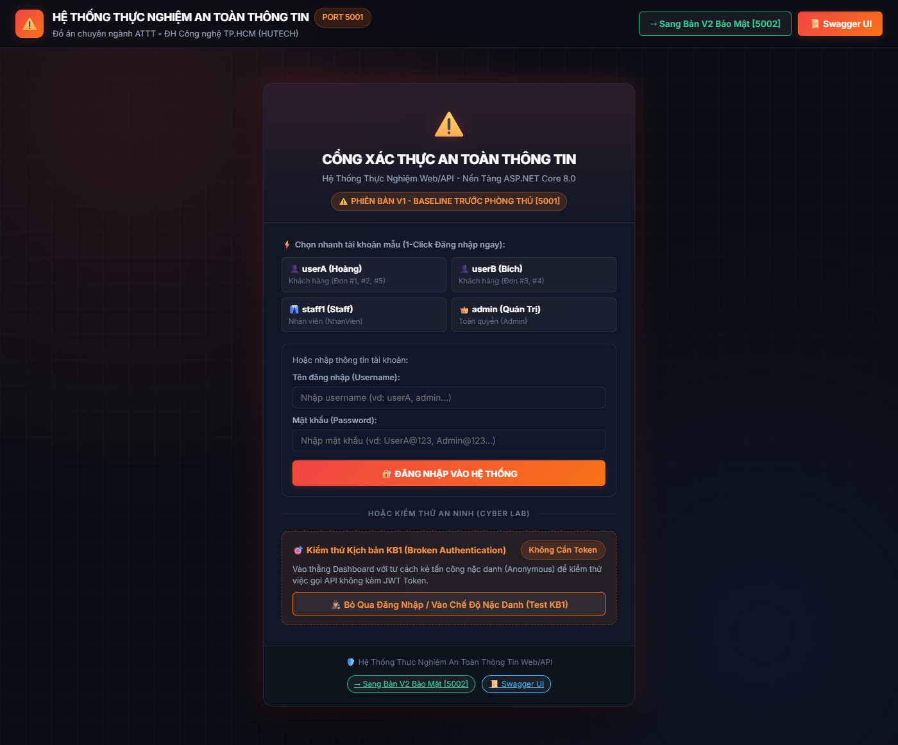

# WebApi.V1_Vulnerable — Phiên Bản Thử Nghiệm Baseline (Red Team)

> **Dự án thành phần thuộc Đồ án Chuyên ngành An toàn thông tin**  
> **Nền tảng:** C# ASP.NET Core 8.0 LTS Web API | **Cổng dịch vụ:** `http://localhost:5001`  
> **Cơ sở dữ liệu:** SQL Server LocalDB (`SecurityLab_V1`)  
> **Swagger UI:** [http://localhost:5001/swagger](http://localhost:5001/swagger)

---

## 1. MỤC ĐÍCH & Ý NGHĨA KHOA HỌC

Trong phương pháp nghiên cứu thực nghiệm đối chứng (**Before / After Testing Model**), phiên bản **`WebApi.V1_Vulnerable`** đóng vai trò là **mẫu đối chứng gốc (Baseline / Red Team)**. Dự án mô phỏng một hệ thống backend RESTful API điển hình viết bằng ASP.NET Core nhưng **cố ý thiếu vắng hoặc cấu hình sai các cơ chế bảo mật tiêu chuẩn**, dẫn đến các lỗ hổng nghiêm trọng nằm trong danh mục **OWASP Top 10 API Security Risks**.

Mục đích chính của phiên bản này:
1. Chứng minh các rủi ro an ninh xảy ra trên thực tế khi lập trình viên không khai thác đúng các tính năng bảo mật sẵn có của nền tảng ASP.NET Core.
2. Cung cấp môi trường mục tiêu để tiến hành kiểm thử thâm nhập (Penetration Testing) và ghi nhận dữ liệu đối chứng (mã HTTP `200 OK`, rò rỉ dữ liệu).

---

## 2. KIẾN TRÚC GIAO DIỆN 2 TẦNG (TWO-VIEW ARCHITECTURE)

Ứng dụng tích hợp sẵn giao diện web tại `http://localhost:5001` với tông màu **Đỏ Cảnh Báo (Red Alert)** gồm 2 tầng giao diện độc lập:

### 2.1 Cổng Xác Thực Tập Trung (Login Portal)
* Phân tách màn hình đăng nhập độc lập trước khi vào hệ thống.
* Tích hợp chức năng **"Bỏ Qua Đăng Nhập / Vào Chế Độ Nặc Danh"** phục vụ kiểm thử ngay kịch bản **KB1 (Broken Authentication)** khi gọi API mà không có Token Bearer.


*Hình 1: Cổng xác thực kính mờ của Bản V1 hỗ trợ chọn nhanh tài khoản mẫu hoặc vào chế độ nặc danh.*

---

### 2.2 Bảng Điều Khiển Nghiệp Vụ & Giám Sát (Dashboard)
* Sau khi đăng nhập (hoặc vào chế độ nặc danh), hệ thống hiển thị Dashboard quản trị doanh nghiệp hoàn chỉnh.
* Bảng điều khiển gồm các tab: **Quản lý Đơn hàng (/api/orders)**, **Tạo Đơn Hàng Mới**, **Quản trị Người dùng (/api/admin/users)** và **Live HTTP Inspector** giám sát trực tiếp yêu cầu/phản hồi.


*Hình 2: Giao diện tổng quan Web V1 tại cổng 5001 với tông đỏ cảnh báo và các chức năng nghiệp vụ tương tác thực tế.*

---

## 3. DANH SÁCH 8 LỖ HỔNG THỰC NGHIỆM ĐỐI CHỨNG (KB1 – KB8)

Toàn bộ các lỗ hổng đều được lập trình trực tiếp trong các Controller của ASP.NET Core để phục vụ thực nghiệm:

### 3.1 Nhóm 4 kịch bản cốt lõi (Khớp 100% Đề cương)

| Kịch bản | Tên lỗ hổng & Endpoint | Cơ chế bị thiếu trên ASP.NET Core | Cách thực nghiệm trực tiếp |
| :---: | :--- | :--- | :--- |
| **KB1** | **Broken Authentication**<br>`GET /api/orders` | Endpoint không khai báo thuộc tính `[Authorize]`. Bất kỳ ai không có Token vẫn truy xuất được toàn bộ đơn hàng (`200 OK`). | Vào chế độ Nặc danh (Anonymous) &rarr; Bảng đơn hàng vẫn tải và để lộ toàn bộ danh sách đơn hàng nội bộ. |
| **KB2** | **Broken Function Level Authorization (RBAC)**<br>`GET /api/admin/users` | Không khai báo `[Authorize(Roles = "Admin")]`. Khách hàng thường `userA` vẫn xem được danh sách Admin và **mật khẩu Plaintext** (`200 OK`). | Đăng nhập tài khoản `userA` &rarr; Bấm sang tab "👥 Quản Trị Người Dùng" &rarr; Hệ thống trả về toàn bộ tài khoản kèm mật khẩu. |
| **KB3** | **Broken Object Level Authorization (BOLA / IDOR)**<br>`GET /api/orders/{id}` | Trong Action `GetOrderById`, không đối chiếu `order.UserId` với `User.Claims`. `userA` đổi `id=3` xem trộm toàn bộ đơn của `userB` (`200 OK`). | Đăng nhập `userA` &rarr; Tại ô "Xem Đơn hàng theo ID", nhập ID `3` &rarr; Xem trộm toàn bộ đơn hàng của `userB`. |
| **KB4** | **SQL Injection & Data Leakage**<br>`GET /api/orders/search?keyword=...` | Sử dụng ghép chuỗi SQL thô nối trực tiếp tham số vào câu lệnh. Chuỗi `' OR 1=1 --` làm sai lệch mệnh đề `WHERE`, đổ sạch toàn bộ CSDL (`200 OK`). | Tại ô "Tìm kiếm Đơn hàng", nhập chuỗi `' OR 1=1 --` rồi bấm Tìm &rarr; Toàn bộ cơ sở dữ liệu bị kết xuất. |

---

### 3.2 Nhóm 4 kịch bản phòng thủ chiều sâu mở rộng (Defense-in-Depth)

| Kịch bản | Tên lỗ hổng & Endpoint | Phân tích rủi ro an ninh trên V1 |
| :---: | :--- | :--- |
| **KB5** | **Lack of Token Revocation (Token Replay)**<br>`POST /api/auth/logout` -> `GET /api/auth/me` | Khi Logout, máy chủ chỉ trả thông báo mà không thu hồi Token. Kẻ tấn công đánh cắp JWT cũ vẫn tiếp tục sử dụng để gọi API bình thường (`200 OK`). |
| **KB6** | **Business Logic Flaw & Mass Assignment & IDOR Xóa**<br>`POST /api/orders` \| `DELETE /api/orders/{id}` | - Cho phép tạo đơn với số tiền âm `-999,999đ` (`200 OK`).<br>- Client tự gán `UserId` của người khác hoặc gán `Status="Completed"`.<br>- `userA` gửi lệnh xóa trái phép đơn hàng #3 của `userB`. |
| **KB7** | **Insecure File Upload & Missing Magic-Bytes Check**<br>`POST /api/orders/{id}/upload` | Chỉ kiểm tra phần mở rộng tệp đơn giản hoặc tin cậy `Content-Type`. Cho phép tải lên tệp nguy hiểm như `webshell.jpg.aspx` hoặc script giả dạng ảnh (`200 OK`). |
| **KB8** | **Lack of Resources & Rate Limiting (Spam / Brute-Force)**<br>`POST /api/auth/login` \| `GET /api/orders/rate-test` | Không áp dụng cơ chế giới hạn tần suất (Rate Limiting). Kẻ tấn công có thể spam liên tục hàng ngàn request mà không hề bị chặn, gây cạn kiệt tài nguyên máy chủ. |

---

## 4. HƯỚNG DẪN KHỞI ĐỘNG & KIỂM THỬ BẢN V1

### Khởi động độc lập
Tại thư mục gốc `ĐACN`, mở terminal PowerShell và chạy:
```powershell
dotnet run --project WebApi.V1_Vulnerable/WebApi.V1_Vulnerable.csproj --urls=http://localhost:5001
```

* **Giao diện Web:** Mở trình duyệt truy cập: [http://localhost:5001](http://localhost:5001)
* **Swagger UI:** Mở trình duyệt truy cập: [http://localhost:5001/swagger](http://localhost:5001/swagger)
