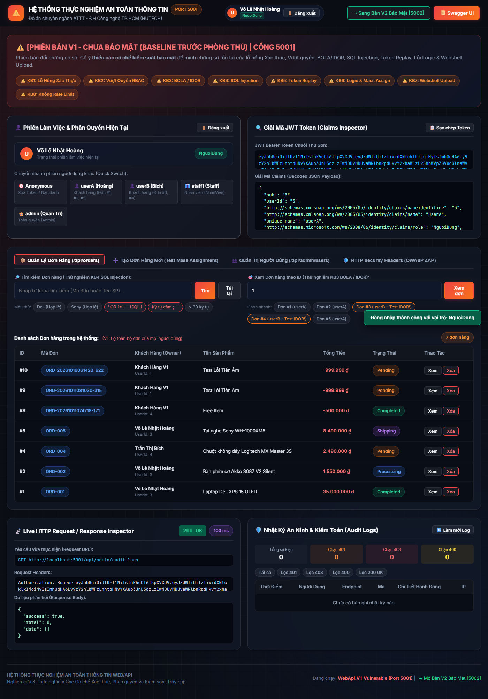
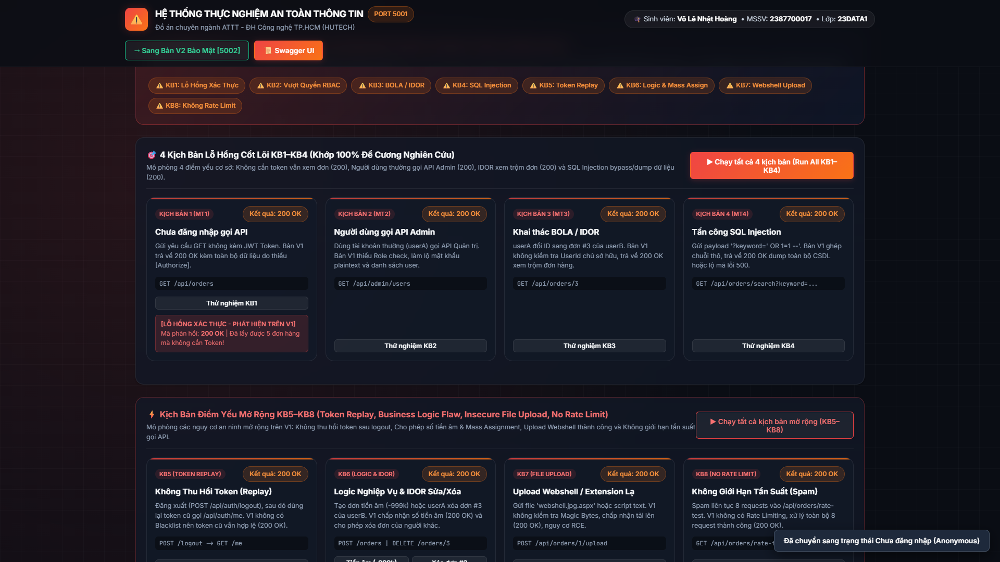
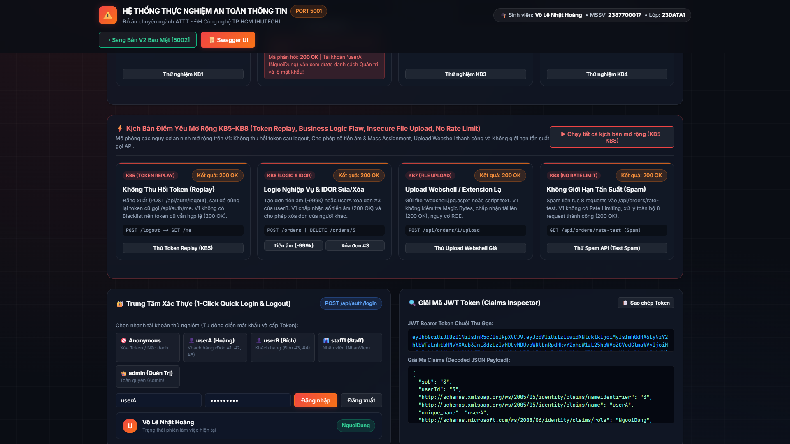
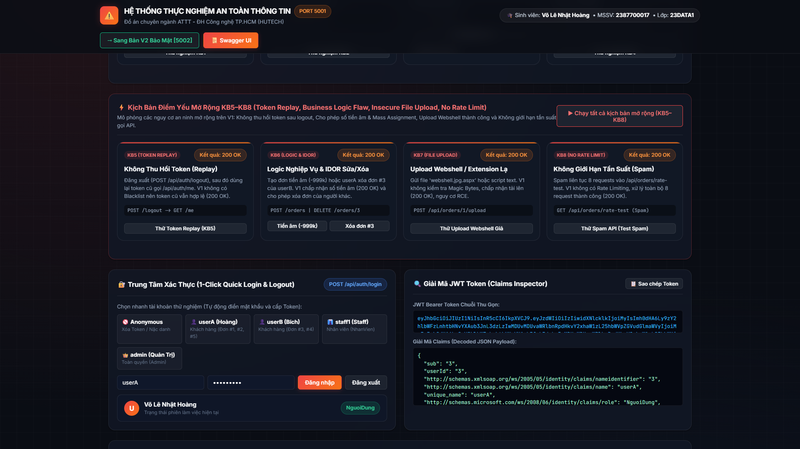
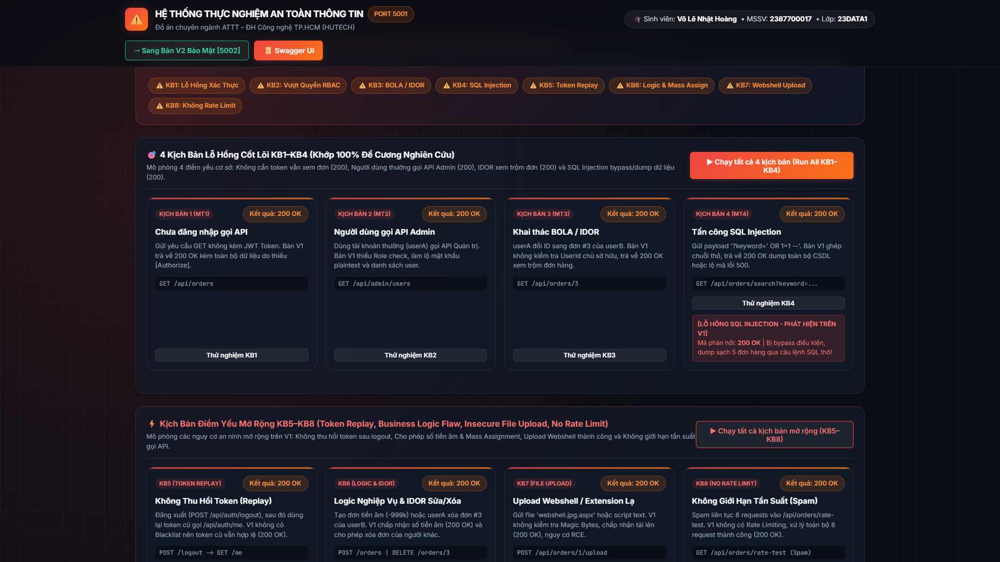
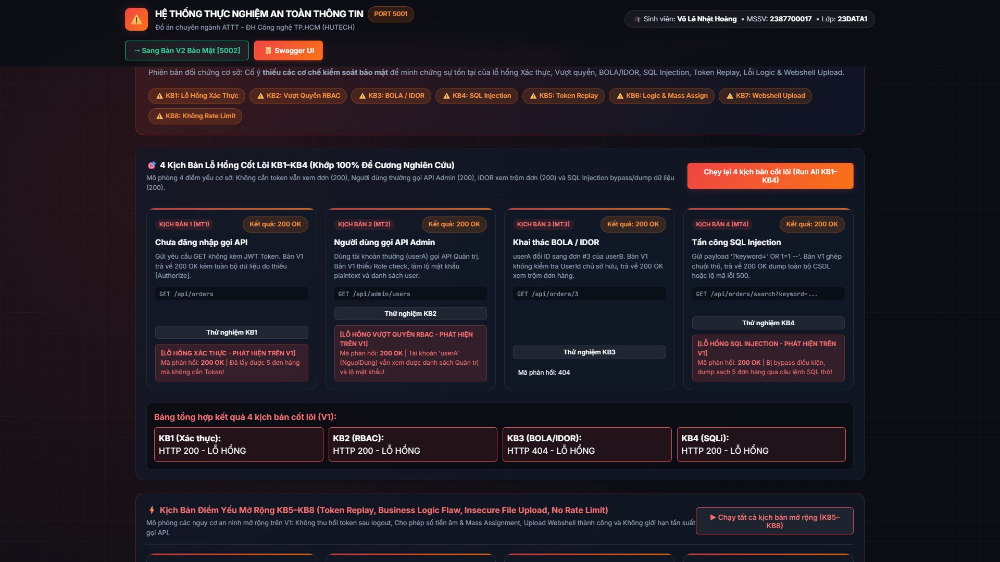
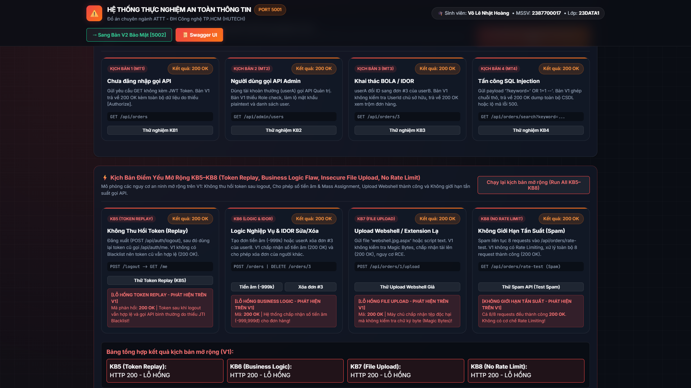

# 🔴 WEB V1 (`WebApi.V1_Vulnerable`) — PHIÊN BẢN BASELINE CHƯA BẢO MẬT (RED TEAM)

- **Địa chỉ chạy:** `http://localhost:5001` (Swagger UI: `http://localhost:5001/swagger`)
- **Cơ sở dữ liệu:** `SecurityLab_V1` (SQL Server LocalDB)
- **Sinh viên thực hiện:** **Võ Lê Nhật Hoàng** (MSSV: `2387700017` - Lớp: `23DATA1` - Ngành An toàn thông tin HUTECH)

---

## 1. MỤC ĐÍCH CỦA WEB V1 TRONG ĐỒ ÁN

**Web V1 (`WebApi.V1_Vulnerable`)** là phiên bản **Before (Baseline chưa bảo mật)**, đóng vai trò môi trường mục tiêu để thực hiện các kịch bản **Tấn công & Khai thác lỗ hổng (Red Team Exploitation)**.

Khi bảo vệ đồ án trước Hội đồng, sinh viên mở **Web V1 (`http://localhost:5001`)** để chứng minh hậu quả thực tế khi một hệ thống RESTful API chỉ tập trung vào tính năng nghiệp vụ mà bỏ qua các cơ chế kiểm soát an toàn thông tin.

---

## 2. HÌNH ẢNH GIAO DIỆN & MINH CHỨNG KHAI THÁC LỖ HỔNG TRÊN WEB V1

### 🔴 Hình 1: Giao diện Tổng quan Bảng điều khiển Web V1 (`http://localhost:5001`)

> Giao diện mang tông màu **Đỏ Cảnh Báo**, hiển thị rõ nhãn `[PHIÊN BẢN V1 - CHƯA BẢO MẬT]` và cung cấp 2 hàng nút bấm **1-Click Attack Simulator** (`KB1–KB4` và `KB5–KB8`).

---

### 🔴 Hình 2: Lỗ hổng KB1 — Truy cập API khi chưa đăng nhập (`GET /api/orders` -> `200 OK`)

> **Nguyên nhân kỹ thuật:** Endpoint `GET /api/orders` trong `OrdersController.cs` của V1 thiếu thuộc tính `[Authorize]`. Người dùng nặc danh (`Anonymous`) không cần gửi JWT Token vẫn lấy được toàn bộ danh sách đơn hàng trong CSDL.

---

### 🔴 Hình 3: Lỗ hổng KB2 — Vượt quyền RBAC xem danh sách Admin & Mật khẩu Plaintext (`GET /api/admin/users` -> `200 OK`)

> **Nguyên nhân kỹ thuật:** Endpoint `/api/admin/users` không kiểm tra Role `Admin`, đồng thời bảng `Users` trên V1 lưu mật khẩu dưới dạng văn bản thô (**Plaintext**: `Admin@123`, `Staff@123`, `UserA@123`). Tài khoản thường `userA` gọi API lấy được toàn bộ tài khoản và mật khẩu hệ thống.

---

### 🔴 Hình 4: Lỗ hổng KB3 — Khai thác BOLA / IDOR xem trộm đơn hàng của người khác (`GET /api/orders/3` -> `200 OK`)

> **Nguyên nhân kỹ thuật:** API chỉ truy vấn `_context.Orders.FindAsync(id)` mà không đối chiếu `order.UserId` với danh tính người gọi. `userA` đổi `id=3` xem trộm được đơn hàng `12.500.000 VNĐ` của `userB` (Trần Thị Bích).

---

### 🔴 Hình 5: Lỗ hổng KB4 — Tấn công SQL Injection trích xuất toàn bộ CSDL (`GET /api/orders/search?keyword=' OR 1=1 --` -> `200 OK`)

> **Nguyên nhân kỹ thuật:** API nối chuỗi trực tiếp tham số `keyword` vào câu lệnh SQL thô (`SELECT * FROM Orders WHERE OrderCode LIKE '%...%'`). Khi gửi payload `' OR 1=1 --`, điều kiện `WHERE` luôn đúng (`TRUE`) làm lộ toàn bộ bảng `Orders`.

---

### 🔴 Hình 6: Chạy liên hoàn 4 kịch bản cốt lõi (`Run All KB1–KB4`) trên Web V1

> Cả 4 kịch bản cốt lõi đều báo **ĐỎ (`HTTP 200 - LỖ HỔNG`)**, chứng minh hệ thống V1 bị tổn thương hoàn toàn trước 4 nhóm tấn công trong đề cương.

---

### 🔴 Hình 7: Chạy liên hoàn 4 kịch bản mở rộng (`Run All KB5–KB8`) trên Web V1

> Trên Web V1, cả 4 kịch bản mở rộng đều bị khai thác thành công (`200 OK`):
> - **KB5 (Token Replay):** Sau khi gọi `/api/auth/logout`, JWT cũ vẫn tiếp tục dùng lại được bình thường.
> - **KB6 (Business Logic & Mass Assignment):** Cho phép tạo đơn hàng với số tiền âm (`-999,999 VNĐ`), tự gán `UserId` của người khác và xóa đơn `#3` của `userB`.
> - **KB7 (Unrestricted File Upload):** Cho phép tải lên file độc hại `webshell.jpg.aspx` mà không kiểm tra chữ ký byte (Magic Bytes).
> - **KB8 (No Rate Limit):** Cho phép spam request và thử mật khẩu liên tục không giới hạn.

---

## 3. CÁCH CHẠY RIÊNG WEB V1
Tại thư mục `ĐACN`, chạy lệnh:
```powershell
dotnet run --project WebApi.V1_Vulnerable/WebApi.V1_Vulnerable.csproj --urls=http://localhost:5001
```
