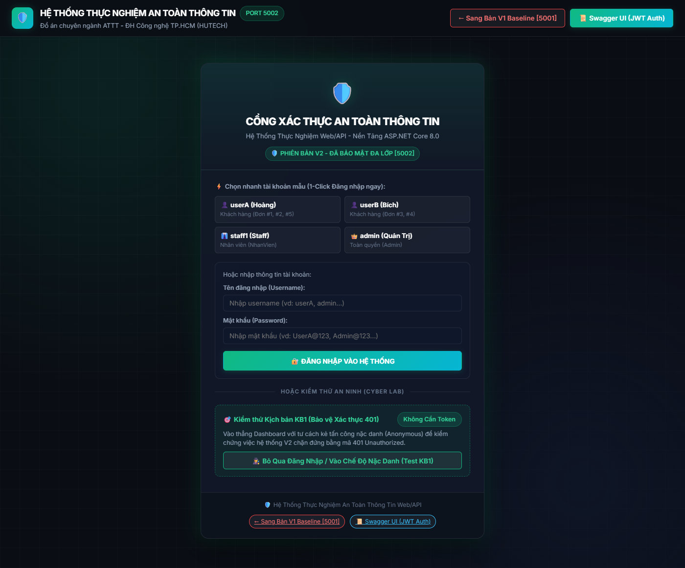
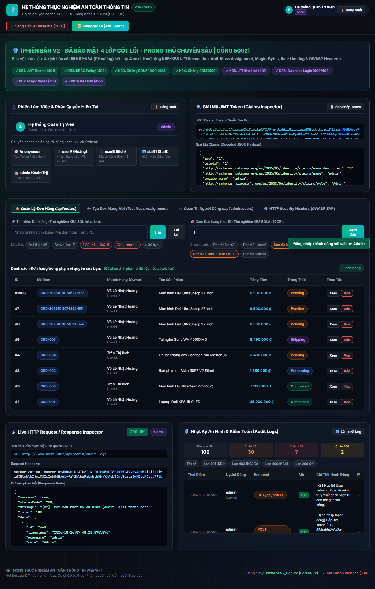

# WebApi.V2_Secure — Phiên Bản Phòng Thủ Chuyên Sâu (Blue Team)

> **Dự án thành phần thuộc Đồ án Chuyên ngành An toàn thông tin**  
> **Nền tảng:** C# ASP.NET Core 8.0 LTS Web API | **Cổng dịch vụ:** `http://localhost:5002`  
> **Cơ sở dữ liệu:** SQL Server LocalDB (`SecurityLab_V2`)  
> **Swagger UI (kèm Authorize JWT):** [http://localhost:5002/swagger](http://localhost:5002/swagger)

---

## 1. MỤC ĐÍCH & Ý NGHĨA KHOA HỌC

Phiên bản **`WebApi.V2_Secure`** đóng vai trò là **mô hình phòng thủ mục tiêu (Hardened / Blue Team)** trong đề tài nghiên cứu. Toàn bộ các cơ chế kiểm soát bảo mật trong dự án này được thiết kế và triển khai **hoàn toàn trên nền tảng ASP.NET Core 8.0 LTS**, giải quyết triệt để 8 bài toán tấn công thực tế từ mức xác thực, phân quyền, kiểm soát đối tượng, kiểm tra tính toàn vẹn dữ liệu cho đến quản lý vòng đời phiên làm việc và phòng chống từ chối dịch vụ.

Dự án chứng minh năng lực phòng thủ đa lớp (**Defense-in-Depth**) có thể đạt được hoàn toàn thông qua việc vận dụng đúng đắn và chuẩn hóa các thành phần gốc của ASP.NET Core:
1. **Pipeline Middleware** xử lý HTTP Request/Response.
2. **Authentication Handler** chuẩn hóa JWT Bearer (RFC 7519).
3. **Authorization Engine** với Policy-Based và Role-Based Access Control (RBAC).
4. **Entity Framework Core 8.0** với Parameterized Queries và bảo vệ toàn vẹn logic nghiệp vụ.
5. **Dependency Injection & In-Memory Services** kiểm soát Blacklist và Rate Limiting.

---

## 2. KIẾN TRÚC GIAO DIỆN 2 TẦNG (TWO-VIEW ARCHITECTURE)

Ứng dụng tích hợp sẵn giao diện web tại `http://localhost:5002` với tông màu **Xanh Lục Bảo Mật (Cyber Green)** gồm 2 tầng giao diện độc lập:

### 2.1 Cổng Xác Thực Tập Trung (Login Portal)
* Phân tách màn hình đăng nhập độc lập trước khi vào hệ thống.
* Tích hợp chức năng chọn nhanh tài khoản mẫu đại diện cho các vai trò (`userA`, `userB`, `staff1`, `admin`) hoặc vào chế độ nặc danh để kiểm chứng phản hồi chặn `401 Unauthorized`.


*Hình 1: Cổng xác thực kính mờ của Bản V2 với phong cách phòng thủ kiên cố.*

---

### 2.2 Bảng Điều Khiển Bảo Mật Đa Lớp (Dashboard)
* Sau khi đăng nhập thành công, hệ thống chuyển sang màn hình Dashboard.
* Bảng điều khiển gồm: Thông tin phiên người dùng, bộ giải mã JWT Claims thời gian thực, bảng kiểm tra 5 OWASP HTTP Security Headers và bảng **Nhật Ký An Ninh & Kiểm Toán (Audit Logs)** theo dõi mọi hành vi vi phạm an ninh (`401`, `403`, `400`, `415`, `429`).


*Hình 2: Giao diện tổng quan Web V2 tại cổng 5002 với tông xanh bảo mật và hệ thống kiểm soát an ninh đa tầng.*

---

## 3. CÁC THÀNH PHẦN BẢO MẬT GỐC CỦA NỀN TẢNG ASP.NET CORE ĐƯỢC ỨNG DỤNG

Dự án áp dụng 100% các công nghệ và cơ chế gốc của nền tảng ASP.NET Core 8.0:

```
                            [ HTTP Request từ Client ]
                                        │
                                        ▼
               ┌──────────────────────────────────────────────────┐
               │    1. ASP.NET Core Kestrel Web Server            │
               └────────────────────────┬─────────────────────────┘
                                        │
                                        ▼
               ┌──────────────────────────────────────────────────┐
               │    2. Custom SecurityAuditMiddleware             │
               │    - Tự động gắn 5 OWASP HTTP Security Headers   │
               │    - Kiểm tra Token Revocation (JTI Blacklist)   │
               └────────────────────────┬─────────────────────────┘
                                        │
                                        ▼
               ┌──────────────────────────────────────────────────┐
               │    3. ASP.NET Core Authentication Middleware     │
               │    - AddAuthentication(JwtBearerDefaults)        │
               │    - TokenValidationParameters (Issuer, Signing) │
               │    - OnChallenge: Trả JSON 401 & ghi AuditLog    │
               └────────────────────────┬─────────────────────────┘
                                        │
                                        ▼
               ┌──────────────────────────────────────────────────┐
               │    4. ASP.NET Core Authorization Middleware      │
               │    - AddAuthorization(Policy "AdminOnly")        │
               │    - OnForbidden: Trả JSON 403 & ghi AuditLog    │
               └────────────────────────┬─────────────────────────┘
                                        │
                                        ▼
               ┌──────────────────────────────────────────────────┐
               │    5. ASP.NET Core Controllers & Action Filters  │
               │    - [Authorize] & [Authorize(Roles = "...")]    │
               │    - Object-Level Check (User.Claims.UserId)     │
               │    - Parameterized LINQ (Chống SQL Injection)    │
               │    - Magic Bytes File Validation (Chống Webshell)│
               │    - IRateLimitingService (Chống Brute-Force)    │
               └────────────────────────┬─────────────────────────┘
                                        │
                                        ▼
               ┌──────────────────────────────────────────────────┐
               │    6. SQL Server LocalDB (SecurityLab_V2)        │
               │    - Mật khẩu băm BCrypt an toàn                 │
               │    - Bảng AuditLogs ghi vết an ninh thời gian thực│
               └──────────────────────────────────────────────────┘
```

---

## 4. CHI TIẾT 8 CƠ CHẾ PHÒNG THỦ THỰC NGHIỆM ĐỐI CHỨNG (KB1 – KB8)

| Kịch bản | Tên cơ chế | Giải pháp trên ASP.NET Core 8.0 | Kết quả thực nghiệm |
| :---: | :--- | :--- | :---: |
| **KB1** | **Xác thực JWT Bearer** | `[Authorize]` trên Controller + `JwtBearerHandler` kiểm tra chữ ký HMAC-SHA256. | Truy cập không Token bị chặn ngay với mã **`401 Unauthorized`**. |
| **KB2** | **Phân quyền RBAC Policy** | `[Authorize(Policy = "AdminOnly")]` + `ClaimsPrincipal.IsInRole("Admin")`. | `userA` gọi API Admin bị chặn ngay với mã **`403 Forbidden`**. |
| **KB3** | **Kiểm soát Đối tượng (IDOR)** | Trích xuất `ClaimTypes.NameIdentifier` và đối chiếu `order.UserId == currentUserId`. | `userA` xem đơn của `userB` bị chặn ngay với mã **`403 Forbidden`**. |
| **KB4** | **Chống SQL Injection** | Regex Validation chặn ký tự cấm + Entity Framework Core Parameterized Queries. | Chuỗi `' OR 1=1 --` bị phát hiện và chặn với mã **`400 Bad Request`**. |
| **KB5** | **Thu hồi Token (JTI Blacklist)** | Singleton `ITokenBlacklistService` lưu `jti` khi Logout, Middleware kiểm tra từng request. | Token cũ sau khi Logout bị chặn với mã **`401 Unauthorized`**. |
| **KB6** | **Toàn vẹn Nghiệp vụ & Anti-Mass Assignment** | DTO Validation (`TotalAmount > 0`) + gán `UserId` tự động từ Claims, kiểm tra sở hữu khi Xóa. | Đơn tiền âm bị chặn với mã **`400 Bad Request`**; Xóa trái phép bị chặn **`403`**. |
| **KB7** | **Kiểm tra Magic Bytes File Upload** | Đọc byte header thực tế (`FF D8 FF`, `89 50 4E 47`, `%PDF`) + chuẩn hóa tên file GUID. | File webshell giả mạo bị từ chối với mã **`415 Unsupported Media Type`**. |
| **KB8** | **Rate Limiting & Chống Spam** | Singleton `IRateLimitingService` áp dụng Sliding Window (5 req/5s/IP). | Spam quá tần suất bị chặn với mã **`429 Too Many Requests`**. |

---

## 5. HƯỚNG DẪN KHỞI ĐỘNG & KIỂM THỬ BẢN V2

### Khởi động độc lập
Tại thư mục gốc `ĐACN`, mở terminal PowerShell và chạy:
```powershell
dotnet run --project WebApi.V2_Secure/WebApi.V2_Secure.csproj --urls=http://localhost:5002
```

* **Giao diện Web:** Mở trình duyệt truy cập: [http://localhost:5002](http://localhost:5002)
* **Swagger UI:** Mở trình duyệt truy cập: [http://localhost:5002/swagger](http://localhost:5002/swagger)
